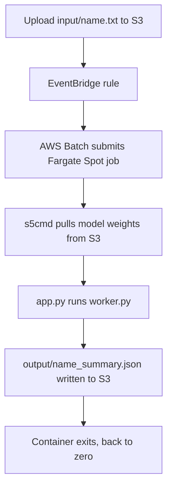

# Serverless Inference

On-demand AI inference on AWS Batch (Fargate Spot) with zero steady-state cost. Nothing runs until a file is uploaded; the job downloads model weights in parallel with `s5cmd`, runs inference, writes the result to S3, and exits.

The shipped use case summarizes text documents with `t5-small`. To change the use case, edit only [`src/worker.py`](src/worker.py).

## How it works



| Path | Purpose |
| --- | --- |
| `infra/` | Terraform: VPC, S3 buckets, ECR, IAM, Batch, EventBridge |
| `src/Dockerfile` | Multi-stage build (s5cmd, CPU-only PyTorch venv, slim runtime, non-root) |
| `src/entrypoint.sh` | Hydrates weights with `s5cmd`, then starts `app.py` |
| `src/app.py` | Reads the input object, calls the worker, writes the output object |
| `src/worker.py` | The model logic. The only file you change for a new use case |
| `scripts/upload_weights.py` | Downloads weights from Hugging Face and uploads them to the model bucket |

## Prerequisites

- AWS credentials with permission to create the resources above
- Terraform, Docker, [uv](https://docs.astral.sh/uv/)
- `uv sync` installs the upload script's dependencies (`boto3`, `huggingface-hub`) into `.venv`

## Deploy

All commands run from the repo root. Pick an image tag first; it must be unique per build, since ECR tags are immutable. Any unique string works, such as a version (`v1`) or a timestamp. If you use git, `git rev-parse --short HEAD` is a good choice.

```bash
TAG=v1

# 1. Create the infrastructure (including the ECR repository)
terraform -chdir=infra init
terraform -chdir=infra apply -var image_tag=$TAG

# 2. Build for Fargate's x86_64 architecture and push
REPO=$(terraform -chdir=infra output -raw ecr_repository_url)
aws ecr get-login-password | docker login --username AWS --password-stdin ${REPO%%/*}
docker build --platform linux/amd64 -t $REPO:$TAG src/
docker push $REPO:$TAG

# 3. Upload model weights
uv run scripts/upload_weights.py \
  --bucket $(terraform -chdir=infra output -raw model_weights_bucket)
```

Push the image and upload the weights before uploading any input file. A job started without an image fails at the pull, and one started without weights fails at the `s5cmd` step ("no object found"). Either way it is retried 3 times.

If the Hugging Face download fails with a 404 on an `xet-read-token` URL, rerun with `HF_HUB_DISABLE_XET=1`.

## Run

```bash
aws s3 cp contract.txt \
  s3://$(terraform -chdir=infra output -raw input_data_bucket)/input/contract.txt
```

The result appears at `output/contract_summary.json`:

```json
{
  "status": "success",
  "model_used": "t5-small",
  "summary": "..."
}
```

Only `.txt` files under `input/` trigger a job. Job logs are in CloudWatch Logs under `/aws/batch/job`.

## Configuration

| Variable | Default | Description |
| --- | --- | --- |
| `aws_region` | `ap-south-1` | Deployment region |
| `availability_zone` | `ap-south-1a` | Must belong to `aws_region` |
| `project_name` | `serverless-inference-framework` | Prefix for resource names. S3 bucket names are global, so change it if creation fails with `BucketAlreadyExists` |
| `image_tag` | none (required) | Image tag in ECR |
| `container_vcpu` | `4.0` | vCPUs per job. More vCPUs give higher S3 download throughput |
| `container_memory` | `8192` | Memory per job, in MiB |

Container environment variables: `MODEL_BUCKET`, `INPUT_BUCKET` (set by Terraform), `INPUT_KEY` (set per job by EventBridge), and optionally `MODEL_NAME` (default `t5-small`) and `S5CMD_WORKERS` (default `64`).

## Use your own model

1. Rewrite `load()`, `process()` and `OUTPUT_SUFFIX` in `src/worker.py`.
2. Add any new dependencies to `src/requirements.txt`.
3. Upload your weights: `uv run scripts/upload_weights.py --bucket <model bucket> --model <hf-repo-id>`. Adjust `ALLOW_PATTERNS` in the script if the model needs files beyond the config, tokenizer and safetensors. Then add `{ name = "MODEL_NAME", value = "<hf-repo-id>" }` to the job definition's `environment` list in `infra/main.tf`.
4. Build and push with a new tag, then `terraform apply -var image_tag=<new tag>`.

Jobs are retried up to 3 times and each attempt times out after an hour. Retries rerun the whole job, so keep outputs deterministic (same input gives the same output key).

## Cost

With no jobs running, the compute cost is zero: there are no instances, and the VPC, Batch resources and EventBridge rule are free. You pay for S3 and ECR storage, CloudWatch log retention, and, while a job runs, Fargate Spot vCPU and memory plus a public IPv4 address. Fargate Spot capacity can be reclaimed by AWS, which the retry setting covers.

## Teardown

```bash
terraform -chdir=infra destroy
```

S3 buckets and the ECR repository must be empty before they can be deleted.
