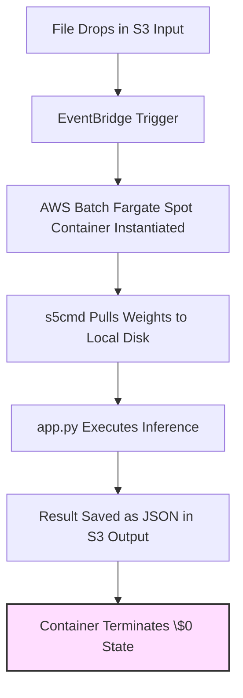

## Serverless Inference

## 1. Product Overview & Vision

The **Serverless Inference** is an open-source, production-grade template for executing **on-demand AI inference with absolute zero steady-state costs**.

It eliminates the financial waste of keeping idle machine learning clusters running 24/7 by coupling a serverless, scale-to-zero container orchestrator with an ultra-fast data hydration architecture. It is designed to be highly extendable, allowing developers to clone the repository and plug in their custom models or processing logic with minimal modifications.

## 2. Core Problem & Value Proposition

- **The Problem:** Hosting AI/ML models on always-on cloud servers is expensive, especially for irregular, asynchronous, or batch workloads. Existing serverless choices (like standard AWS Lambda) have strict limits on container execution sizes, lack native GPU upgrade paths, and struggle with slow initialization times when downloading large model files.
- **The Solution:** An automated pipeline built on **AWS Batch (Fargate Spot)** that stays completely turned off ($0/month) until invoked. When triggered, it uses a high-concurrency engine to download model weights in seconds, executes inference, saves the output, and completely tears itself down.

## 3. System Architecture & Flow



## 4. Functional Requirements

### 4.1 Automated Orchestration & Compute (Scale-to-Zero)

- **Idle State:** The runtime environment must scale to exactly **0 active instances** when no tasks are queued.
- **Compute Profiling:** The container runtime must execute on **AWS Fargate Spot** to minimize resource costs (up to 70% off standard rates).
- **Isolation:** The entire system deploys into a **dedicated VPC** with an egress-only security group. Jobs run in a public subnet with a public IP, with no NAT gateway, to keep idle cost at zero.

### 4.2 High-Speed Data Hydration

- **Parallel Fetching:** The container runtime must avoid standard sequential file streaming and instead utilize a high-performance, multi-threaded client (**`s5cmd`**) to pull model parameters from Amazon S3.
- **Network Performance:** The compute tier must allocate sufficient vCPU configurations (minimum 4 vCPUs) to burst network throughput, ensuring multi-gigabyte models load onto local container disk within seconds.

### 4.3 Extensibility Framework (Plug-and-Play Design)

- **Decoupled Architecture:** The system must strictly separate cloud infrastructure orchestration from machine learning code logic.
- **Worker Abstraction:** Developers must be able to change the entire use case (e.g., changing from summarization to image transformation) by modifying a single decoupled file (`src/worker.py`) without rewriting infrastructure code.

## 5. Target Use Case: Automated Document Intelligence Pipeline

To validate the framework and provide an out-of-the-box working system, v1.0.0 will ship with an automated document processing pipeline.

### 5.1 Real-World Scenario

A legal tech startup needs to analyze contract text files uploaded by users. Uploads occur unpredictably throughout the day—sometimes hundreds in an hour, followed by hours of complete inactivity.

Instead of paying hundreds of dollars a month for a running cluster, the startup uses this framework:

1. **Trigger:** A customer uploads a contract text file (`lease_agreement.txt`) into `s3://data-vault-bucket/input/`.
2. **Cold Start Activation:** The bucket detects the upload and notifies AWS Batch via EventBridge. AWS Batch requests a serverless Fargate container.
3. **Data Hydration:** The container boots up. Before Python initializes, `s5cmd` executes a parallel download of the `t5-small` model weights from the dedicated model S3 bucket onto the container's local disk—completing the transfer in less than 3 seconds.
4. **Execution:** The Python application reads the local model weights instantly. It runs the contract text through a summarization pipeline.
5. **Output Delivery:** The pipeline summarizes the text in chunks, formats the result into a JSON object, and saves it as `s3://data-vault-bucket/output/lease_agreement_summary.json`.
6. **Teardown:** The task terminates. The AWS Batch environment returns to 0 instances. The total infrastructure cost for the entire execution is a fraction of a cent.

### 5.2 Interface Specifications

- **Input File Pathway Format:** `input/<filename>.txt`
- **Output File Pathway Format:** `output/<filename>_summary.json`
- **Output Payload Structure:**

```json
{
  "status": "success",
  "model_used": "t5-small",
  "summary": "This is the generated text summary of the document content..."
}
```

## 6. Technical Stack Reference

- **Infrastructure as Code:** Terraform with the AWS provider pinned to 6.70.0
- **Orchestration & Compute Engine:** AWS Batch (Fargate Spot Profile)
- **High-Speed Transfer Engine:** `s5cmd` (Go-based parallel binary)
- **Application Runtime:** Python 3.10 + Hugging Face Transformers + PyTorch (CPU Optimized)
